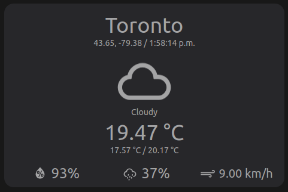

# Weather Tracker &middot; [](https://github.com/kajgm/weathertracker/blob/main/LICENSE) 

A minimal weather tracker, designed for small Raspberry Pi displays (3.5 inch) running in kiosk mode, and just as usable in any browser.



## Contents

- [How it works](#how-it-works)
- [Development](#development)
- [Configuration](#configuration)
- [Display](#display)
- [Container image](#container-image)
- [Deploying with Docker](#deploying-with-docker)
- [Deploying on Kubernetes](#deploying-on-kubernetes)
- [Raspberry Pi kiosk](#raspberry-pi-kiosk)
- [Troubleshooting](#troubleshooting)

## How it works

The app is a static [Vue](https://vuejs.org/) single-page app served by nginx. There is no backend: the **browser** fetches forecasts from [Open-Meteo](https://open-meteo.com/) (every 15 minutes, matching Open-Meteo's update interval) and icons from [Iconify](https://iconify.design/). The server only needs to serve files and never makes outbound requests.

Built with [Node](https://nodejs.org/), [Vue](https://vuejs.org/), [Vite](https://vitejs.dev/) and [Tailwind CSS](https://tailwindcss.com/).

## Development

Requires [Node](https://nodejs.org/en/download) (the image builds with Node 26).

| Task | Command |
|---|---|
| Install dependencies | `npm install` |
| Dev server with hot reload | `npm run dev` |
| Type-check and build for production (`dist/`) | `npm run build` |
| Lint | `npm run lint` |

## Configuration

Settings live at the top of [`src/components/WeatherTracker.vue`](src/components/WeatherTracker.vue). Change them and rebuild the image.

| Setting | Default | Purpose |
|---|---|---|
| `location` | Toronto, `[43.6532, -79.3832]` | Forecast location |
| `params.timezone` | `America/New_York` | Timezone of the location, used for forecast hours |
| `SLOT_OFFSETS_HOURS` | `[3, 6, 9, 12]` | Forecast slots, in hours ahead of now |
| `DIM_START_HOUR` / `DIM_END_HOUR` | `22` / `7` | Night dimming window, in the display's local time |
| `STALE_AFTER_MS` | 31 minutes | Age after which the last-refreshed time turns amber |

## Display

The screen is designed for 480×320 displays read from across a room, so nothing is smaller than 20px:

- **Top:** current conditions icon and temperature, the clock, today's low and high, and wind speed.
- **Middle:** four forecast slots (every 3 hours) with icon, temperature and chance of precipitation. Icons switch to night variants after dark.
- **Bottom right:** the time of the last successful refresh. It turns amber with a warning icon and shows the data's age when updates stop arriving.
- **Night dimming:** between `DIM_START_HOUR` and `DIM_END_HOUR`, the page fades to 35% brightness. This dims the pixels, not the backlight.

## Container image

The [Dockerfile](Dockerfile) builds the app with Node and serves it with [nginx-unprivileged](https://hub.docker.com/r/nginxinc/nginx-unprivileged):

| Property | Value |
|---|---|
| Port | `8080` |
| User | non-root, uid `101` |
| Health check | `GET /healthz` → `200 ok` |
| Caching | hashed `/assets/*` cached for a year; `index.html` is `no-cache`, so open displays pick up new versions on reload |
| Writable paths | `/tmp` only, so the container runs with a read-only root filesystem |
| Platforms | `linux/amd64`, `linux/arm64` |

nginx settings live in [deploy/nginx/default.conf](deploy/nginx/default.conf).

### Published images

[GitHub Actions](.github/workflows/image.yml) lints and builds on every pull request, and publishes multi-arch images to `ghcr.io/kajgm/weathertracker`:

| Trigger | Tags |
|---|---|
| Push to `main` | `main`, `sha-<short>` |
| Git tag `vX.Y.Z` | `X.Y.Z`, `X.Y` |

To release a version:

```sh
git tag v1.0.0
git push origin v1.0.0
```

Pin deployments to an `X.Y.Z` tag rather than `main`.

## Deploying with Docker

1. Install [Docker Engine](https://docs.docker.com/engine/install/) (on a Raspberry Pi, follow the [Debian instructions](https://docs.docker.com/engine/install/debian/)).

   > Tip: run `sudo usermod -aG docker $USER` and log back in to use Docker without `sudo`.

2. Run the published image:

   ```sh
   docker run -d -p 8080:8080 --restart always --name weathertracker ghcr.io/kajgm/weathertracker:1.0.0
   ```

   Or build it yourself from the repo root:

   ```sh
   docker build -t weathertracker .
   docker run -d -p 8080:8080 --restart always --name weathertracker weathertracker
   ```

3. Open <http://localhost:8080> and check health with `curl http://localhost:8080/healthz`.

> Upgrading from an older version? The container now listens on **8080** instead of 80, so the port mapping is `-p 8080:8080`.

## Deploying on Kubernetes

A minimal Deployment and Service. Expose the Service however your cluster does it (Ingress, Gateway API `HTTPRoute`, a tunnel, etc.) by pointing at `weathertracker:80`.

```yaml
apiVersion: apps/v1
kind: Deployment
metadata:
  name: weathertracker
  labels:
    app: weathertracker
spec:
  replicas: 1
  selector:
    matchLabels:
      app: weathertracker
  template:
    metadata:
      labels:
        app: weathertracker
    spec:
      automountServiceAccountToken: false
      securityContext:
        runAsNonRoot: true
        runAsUser: 101
        seccompProfile:
          type: RuntimeDefault
      containers:
        - name: weathertracker
          image: ghcr.io/kajgm/weathertracker:1.0.0
          ports:
            - name: http
              containerPort: 8080
          readinessProbe:
            httpGet: { path: /healthz, port: http }
          livenessProbe:
            httpGet: { path: /healthz, port: http }
            periodSeconds: 30
          resources:
            requests: { cpu: 10m, memory: 16Mi }
            limits: { memory: 64Mi }
          securityContext:
            allowPrivilegeEscalation: false
            readOnlyRootFilesystem: true
            capabilities:
              drop: ["ALL"]
          volumeMounts:
            - name: tmp
              mountPath: /tmp
      volumes:
        - name: tmp
          emptyDir: {}
---
apiVersion: v1
kind: Service
metadata:
  name: weathertracker
spec:
  selector:
    app: weathertracker
  ports:
    - name: http
      port: 80
      targetPort: http
```

Notes:

- **Network policies:** the pod needs no egress at all, not even DNS, so a default-deny policy with ingress allowed only from your ingress controller or tunnel on port **8080** works. Policies match the pod port (8080), not the Service port (80).
- **Upgrades:** change the image tag. Displays load the new version on their next page reload.

## Raspberry Pi kiosk

The Pi only needs Chromium to show the app. Run the container on the Pi itself (see [Deploying with Docker](#deploying-with-docker)), or point the Pi at an instance hosted elsewhere.

[startup.sh](startup.sh) opens the app full-screen in Chromium. It works with both `chromium` (Raspberry Pi OS Bookworm and later) and `chromium-browser` (older releases), and reads the URL from `WEATHERTRACKER_URL`, defaulting to `http://localhost:8080/`:

```sh
chmod +x startup.sh
./startup.sh                                               # local container
WEATHERTRACKER_URL=https://weather.example.com/ ./startup.sh   # hosted instance
```

The script sets `DISPLAY=:0`, so it also works over SSH.

### Start on boot

Create `~/.config/autostart/weathertracker.desktop` (replace `<username>`, and drop the `env ...` part when using the local container):

```ini
[Desktop Entry]
Version=1.0
Type=Application
Terminal=false
Exec=env WEATHERTRACKER_URL=https://weather.example.com/ /home/<username>/weathertracker/startup.sh
Name=weathertracker
```

> If the hosted instance is behind an authentication proxy (for example an SSO login page), the kiosk can't sign in by itself. Allow the Pi's network without login, or serve it from an internal address.

## Troubleshooting

**The screen goes blank after a while.** Disable screen blanking:

```sh
sudo raspi-config
# 2 Display Options > D2 Screen Blanking > No > Finish
```

**Chromium misbehaves on an older 32-bit Pi.** Some older releases worked better with Chromium 88:

```sh
wget "http://archive.raspberrypi.org/debian/pool/main/c/chromium-browser/chromium-browser_88.0.4324.187-rpt1_armhf.deb"
wget "http://archive.raspberrypi.org/debian/pool/main/c/chromium-browser/chromium-codecs-ffmpeg-extra_88.0.4324.187-rpt1_armhf.deb"
sudo apt install --no-install-recommends --allow-downgrades --allow-change-held-packages ./chromium-browser_88.0.4324.187-rpt1_armhf.deb ./chromium-codecs-ffmpeg-extra_88.0.4324.187-rpt1_armhf.deb
```

**The display shows an old version after an upgrade.** Reload the page, or rerun `startup.sh`.
